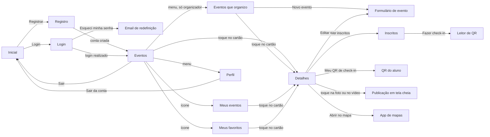
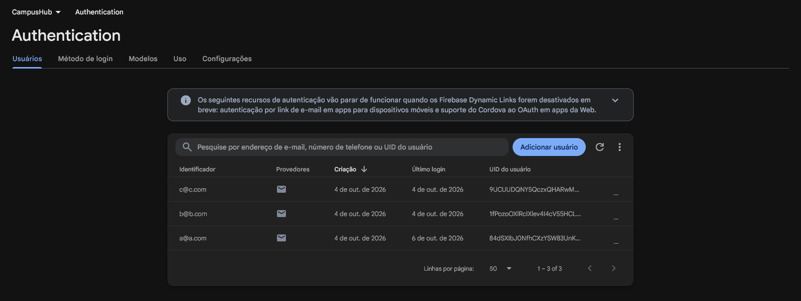
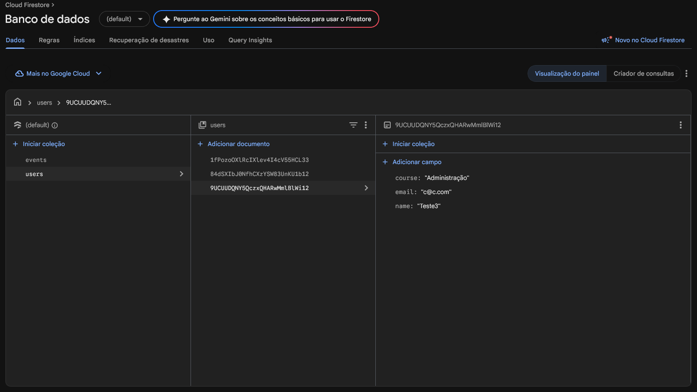
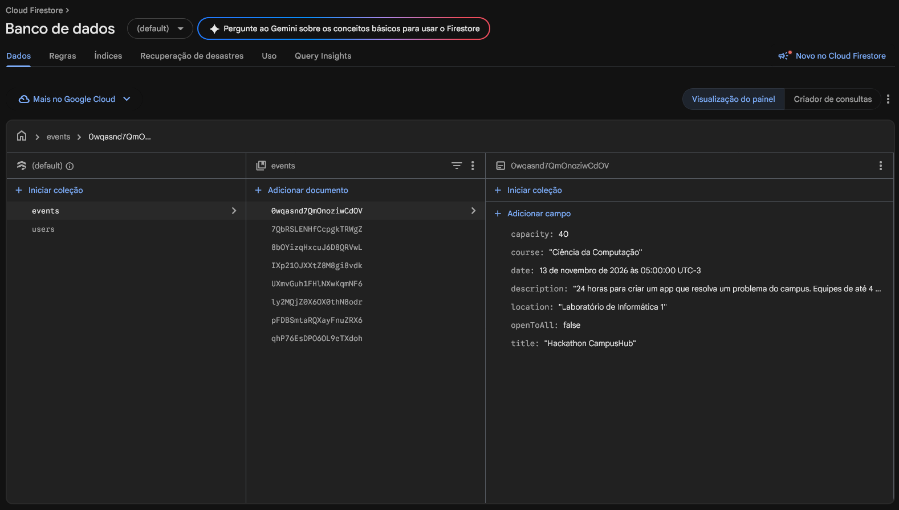
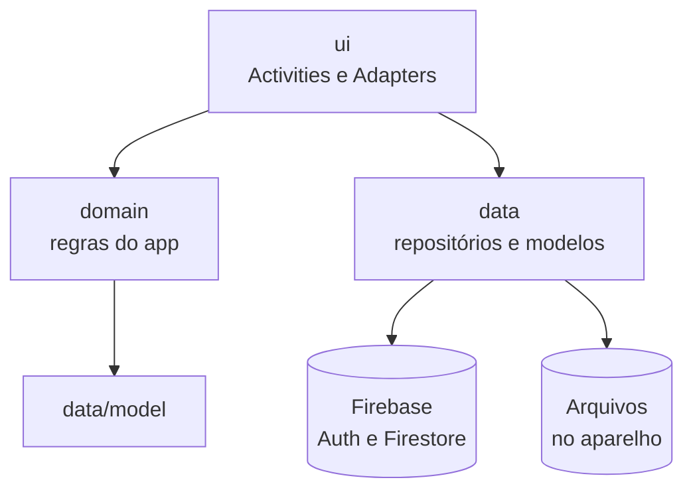
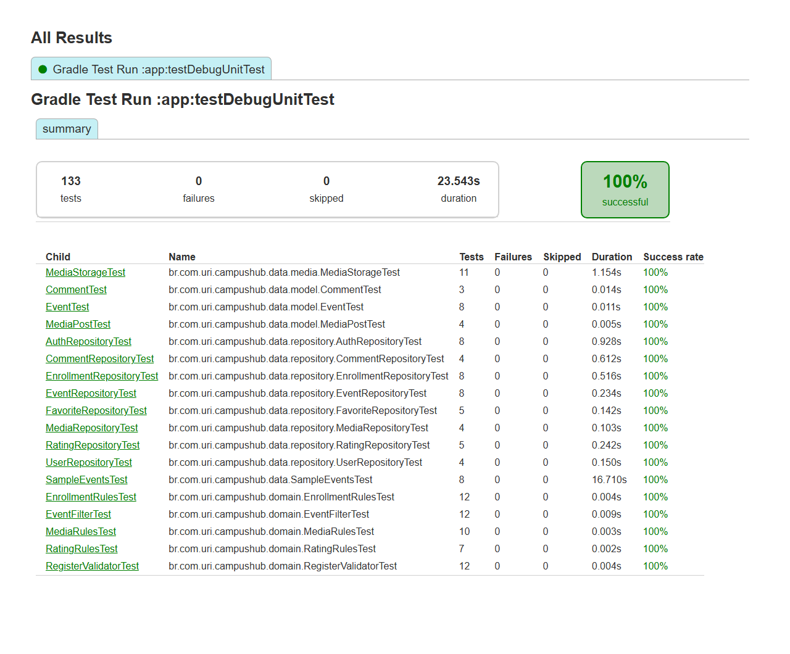
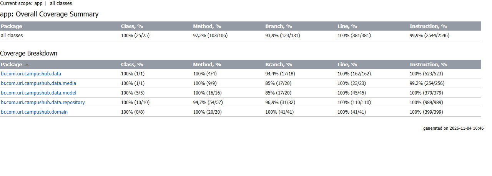
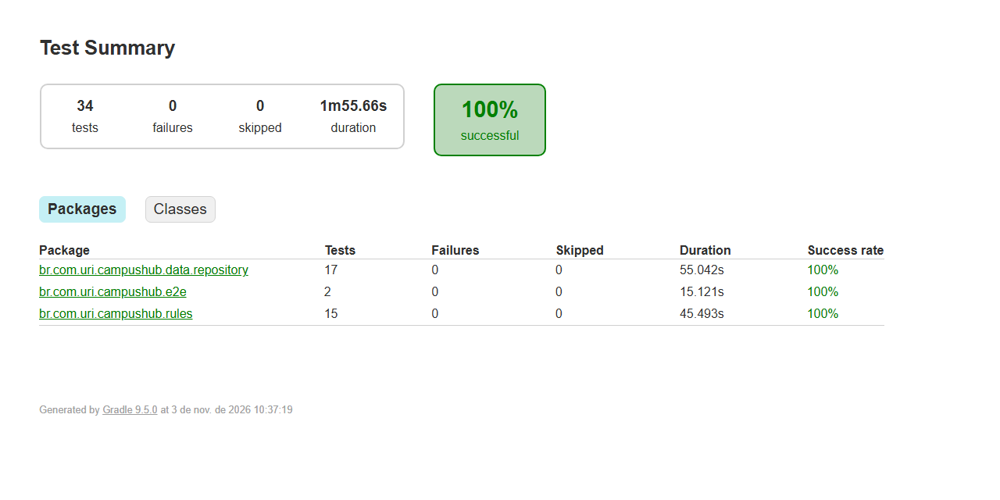

# CampusHub

Plataforma onde alunos podem visualizar os eventos da universidade, se inscrever neles, guardar os favoritos e compartilhar suas experiências. Organizadores criam e gerenciam os próprios eventos, acompanham os inscritos e fazem o check-in pelo QR Code de cada aluno.

App Android feito com Kotlin, Firebase Authentication e Cloud Firestore, todo no plano gratuito (Spark) do Firebase. Usa recursos nativos do aparelho: mapa, câmera, galeria e microfone.

## Funcionalidades

**Conta e perfil**

- **Conta:** registro com nome, curso, email e senha (com confirmação), login, logout e recuperação de senha por email
- **Login automático:** quem já entrou vai direto para os eventos ao abrir o app
- **Perfil:** mostra o email e permite editar o nome e o curso
- **Perfis de acesso:** toda conta criada pelo app é de **aluno**. A conta vira **organizador** quando ganha um documento em `organizers`, criado só pelo console do Firebase. Assim ninguém consegue se promover pelo app

**Eventos**

- **Lista:** cartões com imagem de capa, tipo do evento, data, horário, local, vagas restantes, curso responsável e se o evento é aberto a todos ou exclusivo do curso
- **Busca e filtros:** busca pelo título (sem diferenciar acentos e maiúsculas), filtro por situação (próximos, encerrados ou todos) e por categoria. Os três funcionam juntos
- **Detalhes:** data por extenso, descrição completa, média das avaliações e as ações do evento
- **Inscrição e cancelamento:** controle de vagas, bloqueio quando o evento lota, quando já começou, quando o organizador encerrou as inscrições e, nos eventos exclusivos, para alunos de outros cursos
- **Meus eventos:** só os eventos em que o aluno está inscrito
- **Horário de Brasília:** datas e horários são sempre mostrados e salvos no fuso de Brasília, mesmo que o celular esteja em outro fuso

**Organizadores**

- **Eventos que organizo:** a área do organizador, aberta pelo menu da lista, com os eventos dele em todas as situações e o botão **Novo evento**
- **Formulário de evento:** título, descrição, categoria, data e hora, local no campus, endereço, ponto no mapa, imagem de capa, capacidade e se é exclusivo para o curso do organizador. Os mesmos limites são conferidos no app e nas regras do Firestore
- **Ponto no mapa:** o endereço digitado é localizado no mapa, e o organizador pode tocar no mapa ou arrastar o marcador até o local exato. Também aceita coordenadas coladas do Google Maps (`-29.194076, -54.886996`)
- **Imagem de capa:** escolhida pelo seletor de fotos do Android, reduzida para no máximo 800 pixels e comprimida em JPEG até caber num documento do Firestore (até 500 KB)
- **Situação do evento:** o evento nasce como **rascunho**, que só o organizador vê. Depois anda sempre para a frente:

  | Situação | O que significa | Quando o organizador pode mudar |
  |---|---|---|
  | Rascunho | só o organizador vê e edita | **Publicar evento**, antes do horário de início |
  | Publicado | aparece para os alunos e aceita inscrições | **Encerrar inscrições**, antes do início |
  | Inscrições encerradas | continua visível, mas ninguém mais se inscreve | **Encerrar evento**, 1 hora depois do início |
  | Encerrado | evento realizado: as avaliações são liberadas e nada mais muda | — |

- **Editar e excluir:** o evento pode ser editado até ser encerrado. A capacidade nunca fica abaixo dos inscritos, e a data só muda para o futuro. Excluir só é possível sem nenhum inscrito; com inscritos, o caminho é encerrar
- **Só o dono:** cada organizador vê as ações apenas nos próprios eventos

**Lista de espera**

- Quando o evento lota, o botão vira **Entrar na lista de espera**. O aluno recebe uma senha numerada e vê a posição dele na fila (por exemplo, "2º lugar")
- **Inscrição automática:** quando uma vaga abre (um inscrito cancela ou o organizador aumenta a capacidade), o primeiro da fila é inscrito sozinho, sem precisar estar com o app aberto. Na próxima vez que abrir o evento, ele vê o aviso "Uma vaga abriu e você foi inscrito pela lista de espera!"
- **Ordem justa:** com gente na fila, uma vaga livre é sempre do primeiro da fila, nunca de quem chegou depois. Quem sai da fila e volta pega uma senha nova, no fim
- O aluno pode sair da fila até o horário de início do evento

**Acompanhamento e check-in**

- **Ver inscritos:** nos detalhes do próprio evento, o organizador abre a lista com as vagas ocupadas, o número de check-ins, os inscritos (nome, curso, data da inscrição e se já está presente) e a fila em ordem
- **Meu QR de check-in:** o aluno inscrito abre nos detalhes do evento um QR Code só dele, com a tela no brilho máximo para facilitar a leitura
- **Fazer check-in:** na lista de inscritos, o organizador lê o QR com a câmera. O app confere se o código é do evento e do aluno, registra a presença com a hora do servidor e mostra o resultado: confirmado, já feito, de outro evento, aluno não inscrito ou código que não confere. O botão **Ler próximo** abre a câmera de novo
- **Uma vez só:** cada QR registra um check-in. Depois dele o aluno vê "Check-in feito em 18/11 às 19:20" nos detalhes e não pode mais cancelar a inscrição

**Interação**

- **Favoritos:** coração nos detalhes para favoritar ou desfavoritar, e a tela **Meus favoritos**. Favoritar não é se inscrever: não reserva vaga
- **Comentários:** qualquer aluno logado comenta. Cada comentário mostra o nome do autor e a data, e só o autor pode editar ou excluir o próprio comentário
- **Avaliações:** quem estava inscrito avalia o evento depois que ele termina, com nota de 1 a 5. É uma avaliação por aluno, e a nota pode ser alterada. Os detalhes mostram a média e a quantidade de avaliações

**Localização e publicações**

- **Mapa:** cada evento tem endereço e um ponto no mapa (OpenStreetMap). Nos eventos de exemplo do campus, o ponto fica no prédio do curso, e os eventos em auditório ficam no Prédio 4, onde estão os auditórios. **Abrir no mapa** abre o app de mapas do celular
- **Fotos:** o aluno tira uma foto com a câmera ou escolhe uma da galeria e publica no evento. Tocar na foto abre em tela cheia
- **Áudios:** o aluno grava um áudio de até 1 minuto e publica. Qualquer aluno toca e pausa o áudio na própria lista
- **Vídeos:** o aluno grava um vídeo de até 30 segundos ou escolhe um da galeria (vídeos mais longos são recusados). A lista mostra a miniatura e a duração, e o vídeo toca em tela cheia
- **Autor e data:** toda publicação mostra quem publicou e quando, e só o autor pode excluir
- As publicações não dependem de inscrição, comentários ou avaliações: qualquer aluno logado publica

**Geral**

- **Modo escuro:** todas as telas acompanham o tema do sistema

## Telas

- **Inicial:** nome do app e botões de Login e Registrar
- **Registro:** nome, curso (escolhido numa lista), email, senha e confirmação de senha
- **Login:** email e senha, com o link **Esqueci minha senha**
- **Eventos:** saudação com o nome do aluno, campo de busca, filtros de situação e categoria e os cartões dos eventos
- **Detalhes do evento:** informações completas, média das avaliações, inscrição ou cancelamento, lista de espera, QR de check-in, coração de favorito, sua avaliação (em eventos encerrados), descrição, localização com o mapa, publicações e comentários. Para o organizador dono, também os avisos de situação e os botões de editar, publicar, encerrar, excluir e ver inscritos
- **Publicação em tela cheia:** a foto, ou o vídeo com os controles, e o autor e a data na barra
- **Meus eventos** e **Meus favoritos:** os eventos inscritos ou favoritados, ou um aviso quando a lista está vazia
- **Perfil:** avatar com as iniciais, email e edição do nome e do curso
- **Eventos que organizo:** os eventos do organizador, inclusive os rascunhos, e o botão **Novo evento**
- **Formulário de evento:** criar ou editar, com o mapa para marcar o ponto e a imagem de capa
- **Inscritos:** resumo de vagas, check-ins e fila, as listas de inscritos e de espera e o botão **Fazer check-in**

## Fluxo



1. O app abre na tela **Inicial**. Se já existe uma sessão salva, vai direto para os **Eventos**.
2. No **Registro**, o Firebase cria a conta e o app salva nome, curso e email no Firestore.
3. No **Login**, o link **Esqueci minha senha** manda um email de redefinição pelo Firebase.
4. Na lista de **Eventos**, a busca e os filtros mudam os cartões na hora, sem consultar o Firestore de novo. A lista abre mostrando os próximos eventos.
5. Nos **Detalhes**, o aluno se inscreve ou cancela, entra na lista de espera, mostra o QR de check-in, favorita, comenta e, se o evento já terminou e ele estava inscrito, avalia. Quando uma ação não é permitida, o botão fica desativado mostrando o motivo.
6. Ainda nos **Detalhes**, o mapa mostra onde é o evento, e o botão **Publicar** oferece tirar foto, escolher foto, gravar áudio, gravar vídeo ou escolher vídeo. A câmera e a galeria são as do próprio Android, e o microfone é pedido só na primeira gravação.
7. **Meus eventos** e **Meus favoritos** abrem pelos ícones da barra. **Perfil**, **Eventos que organizo** (só para organizadores) e **Sair** ficam no menu ⋮.
8. O organizador cria o evento como rascunho, publica, acompanha os inscritos e, no dia, faz o check-in lendo o QR de cada aluno. Uma hora depois do início, encerra o evento.

## Banco de dados (Firestore)

```
users/{uid}                          perfil do aluno
    name, course, email
    enrollments/{eventId}            uma inscrição por evento
        eventId, enrolledAt
        fromWaitlist                 só nas inscrições feitas pela fila, até o aluno ver o aviso
    favorites/{eventId}              um favorito por evento
        eventId, favoritedAt

admins/{uid}                         conta que grava os eventos de exemplo (criada no console)
organizers/{uid}                     contas organizadoras (criadas no console, sem campos)

events/{eventId}
    title, description, location, date
    category, course, openToAll
    capacity, enrolledCount
    address, coordinates             endereço e ponto no mapa (GeoPoint)
    organizerId                      uid do organizador dono (vazio nos eventos de exemplo)
    status                           draft, published, closed ou finished
    imageVersion                     versão da capa (0 = sem capa)
    waitlistNext, waitlistHead       próxima senha a entregar e próxima a atender
    attendees/{uid}                  a lista que o organizador acompanha
        name, course, status, since  status: enrolled ou waiting
        checkinToken                 segredo do QR de check-in
        checkedInAt                  hora do check-in (só depois dele)
    waitlist/{uid}                   o lugar do aluno na fila
        ticket, joinedAt, hasAttendee
    waitlistTickets/{senha}          a senha apontando para o aluno
        userId
    comments/{commentId}             comentários do evento
        userId, authorName, text, createdAt, editedAt
    ratings/{uid}                    uma avaliação por aluno
        userId, value, updatedAt
    media/{mediaId}                  publicações de foto, áudio e vídeo
        userId, authorName, type, fileName, durationMs, createdAt

eventImages/{eventId}                capa do evento
    jpeg, version                    bytes do JPEG e a mesma versão do evento
```

- O `uid` vem do Firebase Authentication, o que liga o perfil à conta.
- **Ids que evitam repetição:** inscrições e favoritos usam o id do evento, e avaliações, lugares na fila e a lista de inscritos usam o uid do aluno. Assim o aluno não se inscreve duas vezes, não entra duas vezes na fila e tem uma única avaliação por evento.
- **Transações:** inscrever, cancelar, entrar e sair da fila e fazer o check-in mudam vários documentos juntos. Ou tudo é gravado, ou nada. Se dois alunos tentarem a última vaga ao mesmo tempo, o Firestore repete uma das tentativas, que encontra o evento lotado. Se o mesmo QR for lido em dois celulares ao mesmo tempo, só um check-in é gravado.
- **Lista de espera sem servidor:** a fila funciona como senhas de atendimento. `waitlistNext` é a próxima senha a entregar e `waitlistHead` a próxima a atender. Quando uma vaga abre, o próprio app de quem liberou a vaga (ou de quem abrir o evento depois) inscreve o dono da senha da vez, e as regras do Firestore conferem que é mesmo o primeiro da fila. Por isso não é preciso Cloud Functions nem o plano pago.
- **Lista do organizador (`attendees`):** o perfil de cada aluno é privado. Em vez de abrir os perfis para o organizador, cada aluno grava dentro do evento só o nome e o curso, e as regras conferem que são iguais aos do perfil. Inscrições feitas antes dessa lista existir entram nela quando o aluno abre o evento.
- **QR de check-in:** o texto do QR é `campushub-checkin:v1:{evento}:{aluno}:{segredo}`. O segredo tem 32 caracteres sorteados pelo gerador seguro do Android e só o próprio aluno e o organizador dono conseguem lê-lo, então um QR não pode ser inventado. O QR é desenhado no celular do aluno (ZXing) a cada vez que ele abre a janela, sem ser salvo.
- **Capa do evento:** o Storage do Firebase exige o plano pago, então a capa fica num documento separado do Firestore, gravado no mesmo lote que o `imageVersion` do evento. Separada, a lista de eventos não baixa as imagens junto; cada capa é baixada quando aparece e fica guardada no celular pelo Glide até a versão mudar.
- **Média das avaliações:** calculada pelo próprio Firestore com uma consulta de agregação (`average` e `count`), sem baixar as notas uma a uma. A posição na fila usa o mesmo recurso (`count`).
- **Comentários:** guardam o nome do autor no próprio documento, para não buscar o perfil de cada um. As datas (`createdAt`, `editedAt`) vêm do servidor, não do relógio do celular.
- **Publicações:** o Firestore guarda só os dados (autor, tipo, nome do arquivo, duração e data). O arquivo fica na pasta privada do app, no aparelho de quem publicou, como o enunciado permite. Em outro aparelho, a publicação aparece com o aviso de que o arquivo está só no aparelho do autor. Ao excluir, o app apaga o documento e o arquivo.
- **Eventos de exemplo:** na primeira execução de uma conta admin, se a coleção `events` estiver vazia, o app grava 12 eventos (`SampleEvents.kt`). São 8 próximos e 4 já encerrados, de vários cursos e categorias. Sempre que a lista carrega, os eventos já gravados recebem a sala, o endereço e o ponto no mapa do exemplo de mesmo título. Só a conta admin tem permissão para essas gravações: para os outros alunos, a lista vazia mostra "Nenhum evento cadastrado ainda". Os eventos de exemplo não têm organizador e terminam no horário de início; os de organizador terminam quando ele encerra.
- **Pontos no mapa:** o OpenStreetMap não tem os prédios do campus desenhados. As coordenadas dos prédios e do Fórum de Santiago foram tiradas do Google Maps, usando a rotatória da entrada do campus como referência.

### Regras de segurança

O arquivo `firestore.rules` roda nos servidores do Firebase, então vale mesmo que alguém altere o app. O aluno é identificado pelo token do Authentication (`request.auth.uid`), nunca por um dado enviado pelo app. O que não está liberado é negado.

| Dados | Quem pode |
|---|---|
| `users/{uid}` | só o próprio aluno lê. No cadastro, o email do perfil tem que ser o da conta; depois, só nome e curso mudam |
| `favorites` | só o dono lê, grava e apaga |
| `enrollments` | só o dono, em evento publicado, futuro, aberto ao curso dele e sem fila, com o `enrolledCount` subindo 1 e o aluno entrando na lista do organizador na mesma transação. Pela fila, qualquer conta inscreve só o dono da senha da vez |
| `events` | qualquer aluno logado lê os publicados; os rascunhos só o dono. O organizador cria e edita só os próprios eventos e muda a situação só para a frente, nos horários da tabela de situações. O aluno só mexe no `enrolledCount` e nas senhas da fila, junto com a própria inscrição ou o próprio lugar na fila |
| `eventImages` | quem pode ver o evento lê a capa; só o organizador dono grava, até 500 KB e com a mesma versão do evento |
| `attendees` | a lista inteira, só o organizador dono. Cada aluno grava a própria ficha, com nome e curso iguais aos do perfil e a situação verdadeira. O check-in só vem do organizador dono, para aluno inscrito, uma vez e com a hora do servidor |
| `waitlist` e `waitlistTickets` | o aluno entra com a próxima senha e sai quando quer; ninguém troca de senha nem fura a fila |
| `comments` | o autor é sempre quem está logado, com texto de até 500 caracteres. Só o autor edita e exclui |
| `ratings` | só o próprio aluno, inscrito e com o evento encerrado, com nota de 1 a 5 |
| `media` | tipo `photo`, `audio` ou `video`, com o autor sendo quem está logado. Só o autor exclui |
| `admins` e `organizers` | nenhum aluno grava; o documento é criado à mão no console. Cada conta só consegue ver se ela mesma é organizadora |

O console do Firebase não segue as regras, por isso ele é usado para criar o admin, os organizadores e os ajustes manuais.

### Dados no console do Firebase

Contas criadas pela tela de Registro, em **Authentication > Usuários**:



Perfil salvo no Firestore pelo Registro, na coleção `users`. O id do documento é o mesmo UID do Authentication:



Um dos eventos de exemplo na coleção `events`, com o curso e o tipo de acesso:



## Arquitetura

O código é dividido em três camadas. Cada uma só conhece a de baixo:



- **`ui`** mostra os dados e reage aos toques. As telas não chamam o Firebase direto: pedem aos repositórios e perguntam às regras o que pode ser feito.
- **`data`** é o único lugar que fala com o Firebase, com o serviço de endereços do Android e com os arquivos das publicações. Cada repositório cuida de uma parte dos dados e devolve uma `Task`, que a tela trata com `addOnSuccessListener` e `addOnFailureListener`.
- **`domain`** guarda as regras do app em Kotlin puro, sem Android nem Firebase: validação do cadastro e do formulário de evento, busca e filtros, quando o aluno pode se inscrever, cancelar, entrar na fila e avaliar, o que o organizador pode fazer com o evento, o formato do QR de check-in e a conferência dele, o fuso de Brasília e os limites das imagens, áudios e vídeos. Por isso essas regras podem ser testadas sem emulador.

```
app/src/main/
├── java/br/com/uri/campushub/
│   ├── ui/
│   │   ├── auth/
│   │   │   ├── MainActivity.kt           tela inicial e login automático
│   │   │   ├── RegisterActivity.kt       cria a conta e o perfil
│   │   │   └── LoginActivity.kt          login e recuperação de senha
│   │   ├── events/
│   │   │   ├── EventsActivity.kt         lista de eventos, busca e filtros
│   │   │   ├── MyEventsActivity.kt       Meus eventos e Meus favoritos (a mesma tela, com listas diferentes)
│   │   │   ├── EventAdapter.kt           cartões dos eventos
│   │   │   └── EventChips.kt             etiquetas de curso e de acesso
│   │   ├── details/
│   │   │   ├── EventDetailsActivity.kt   detalhes, inscrição, fila, favorito, comentários, avaliação e ações do organizador
│   │   │   ├── CommentAdapter.kt         lista de comentários e menu de editar/excluir
│   │   │   └── EventMap.kt               mapa do evento (osmdroid) e Abrir no mapa
│   │   ├── organizer/
│   │   │   ├── OrganizerEventsActivity.kt  Eventos que organizo
│   │   │   ├── EventFormActivity.kt      criar e editar evento
│   │   │   ├── MapPointPicker.kt         marcar o ponto exato no mapa do formulário
│   │   │   ├── AttendeesActivity.kt      inscritos, fila e leitura do QR
│   │   │   └── AttendeeAdapter.kt        resumo, cabeçalhos e alunos da lista
│   │   ├── checkin/
│   │   │   ├── CheckinQrDialog.kt        QR do aluno, com o brilho no máximo
│   │   │   ├── QrCodeImage.kt            desenha o QR (ZXing)
│   │   │   ├── QrScanner.kt              leitor de QR do Google Play Services
│   │   │   └── CheckinResultDialog.kt    resultado do check-in e Ler próximo
│   │   ├── media/
│   │   │   ├── MediaSection.kt           cartão Publicações: publicar, listar e excluir
│   │   │   ├── MediaAdapter.kt           foto, áudio ou vídeo de cada publicação
│   │   │   ├── MediaViewerActivity.kt    foto ou vídeo em tela cheia
│   │   │   ├── AudioPlayer.kt            toca um áudio por vez na lista
│   │   │   ├── RecordAudioDialog.kt      janela de gravação com o tempo e o limite
│   │   │   └── CaptureShortVideo.kt      pede à câmera o limite de 30 segundos
│   │   ├── profile/
│   │   │   └── ProfileActivity.kt        dados do aluno
│   │   └── common/
│   │       ├── ScreenSetup.kt            barra superior e espaço das barras do sistema e do teclado
│   │       ├── Avatar.kt                 iniciais do perfil e dos comentários
│   │       └── EventImages.kt            mostra a capa do evento (Glide), com cache pela versão
│   ├── data/
│   │   ├── model/
│   │   │   ├── Event.kt                  evento, formatos de data, vagas, situação e curso
│   │   │   ├── EventStatus.kt            rascunho, publicado, inscrições encerradas e encerrado
│   │   │   ├── EventDraft.kt             campos do formulário de evento
│   │   │   ├── EventImageChange.kt       manter, trocar ou remover a capa ao salvar
│   │   │   ├── Attendee.kt               aluno na lista do organizador
│   │   │   ├── Role.kt                   aluno ou organizador
│   │   │   ├── Comment.kt                comentário
│   │   │   ├── User.kt                   perfil do aluno
│   │   │   ├── MediaPost.kt              publicação de foto, áudio ou vídeo
│   │   │   └── RatingSummary.kt          média e quantidade de avaliações
│   │   ├── repository/
│   │   │   ├── AuthRepository.kt         login, cadastro, recuperação de senha e logout
│   │   │   ├── UserRepository.kt         perfil em users/{uid} e o perfil de acesso
│   │   │   ├── EventRepository.kt        lista, eventos do organizador, criar, editar, mudar situação e excluir
│   │   │   ├── EventImageRepository.kt   capa em eventImages/{eventId}
│   │   │   ├── EnrollmentRepository.kt   inscrição e cancelamento (transações)
│   │   │   ├── WaitlistRepository.kt     entrar e sair da fila e inscrever o primeiro da fila
│   │   │   ├── AttendeeRepository.kt     lista do organizador e check-in (transação)
│   │   │   ├── FavoriteRepository.kt     favoritar e desfavoritar
│   │   │   ├── CommentRepository.kt      listar, criar, editar e excluir comentários
│   │   │   ├── RatingRepository.kt       nota do aluno e média do evento
│   │   │   └── MediaRepository.kt        listar, criar e excluir publicações
│   │   ├── location/
│   │   │   └── AddressGeocoder.kt        endereço → ponto no mapa (Geocoder do Android)
│   │   ├── media/
│   │   │   ├── MediaStorage.kt           arquivos das publicações na pasta do app
│   │   │   ├── AudioRecorder.kt          gravação do microfone
│   │   │   ├── ImageCompressor.kt        reduz a foto escolhida para a capa
│   │   │   └── JpegEncoder.kt            comprime em JPEG até caber no limite
│   │   └── SampleEvents.kt               eventos de exemplo e pontos dos prédios
│   └── domain/
│       ├── RegisterValidator.kt          validação do cadastro
│       ├── EventFormValidator.kt         validação do formulário de evento
│       ├── EventDateTime.kt              data e hora escolhidas → data do evento
│       ├── CampusTime.kt                 fuso de Brasília e formatos de data
│       ├── CoordinateParser.kt           coordenadas coladas → ponto no mapa
│       ├── ImageSizing.kt                tamanho da capa reduzida
│       ├── EventFilter.kt                ordem da lista, busca e filtros
│       ├── EnrollmentRules.kt            quando se inscrever e cancelar
│       ├── WaitlistRules.kt              quando entrar e sair da fila
│       ├── OrganizerRules.kt             quem gerencia o evento e quando publicar, encerrar e excluir
│       ├── AttendeeOverview.kt           ordem e números da lista de inscritos
│       ├── AttendeeRules.kt              quando a ficha do aluno na lista precisa ser atualizada
│       ├── CheckinCode.kt                segredo e texto do QR de check-in
│       ├── CheckinRules.kt               quando mostrar o QR e a conferência do check-in
│       ├── RatingRules.kt                quando avaliar e limites da nota
│       └── MediaRules.kt                 quem exclui e limites de áudio e vídeo
├── res/
│   ├── layout/                           telas, cartões, itens das listas e diálogos
│   ├── drawable/                         ícones e fundos
│   ├── color/                            cores das opções de filtro (marcada ou não)
│   ├── menu/                             menus da barra, dos comentários e das publicações
│   ├── xml/                              regras de backup e a pasta que o FileProvider abre para a câmera
│   ├── values/                           textos, cores, temas, estilos, medidas, cursos e categorias
│   └── values-night/                     cores e temas do modo escuro
└── AndroidManifest.xml
```

- **Repositórios** recebem o `FirebaseAuth` e o `FirebaseFirestore` pelo construtor, com a instância padrão como valor inicial. As telas usam o padrão, e os testes podem passar o Firebase Emulator.
- **Regras** devolvem um `enum` ou uma `sealed class` com o resultado (por exemplo `EnrollmentRules.Status.SOLD_OUT` ou `CheckinRules.Outcome.AlreadyDone`). A tela escolhe a mensagem e o estado do botão a partir dele, então a regra não depende de textos nem de layout.
- **Mesmas regras nos dois lados:** cada regra do `domain` tem a sua equivalente no `firestore.rules`. O app usa a dele para mostrar ou esconder os botões; o servidor usa a dele para aceitar ou negar a gravação.
- **Navegação** com `Intent`. As telas de detalhes, do formulário e dos inscritos recebem só o id do evento e buscam os dados atualizados.
- **Barras do sistema e teclado:** a partir do Android 15 o app desenha atrás das barras. As telas com barra própria usam o `ScreenSetup.kt`, que reserva o espaço da barra de status, da barra de navegação e do teclado. Assim o campo de comentário continua visível enquanto o aluno digita.
- **Adapters** só mostram os dados e avisam a tela quando algo é tocado.
- **Textos** da interface ficam em `strings.xml`, e os cursos e as categorias em `string-array`.
- **Mapa isolado:** todo o código do osmdroid fica em `EventMap.kt` e `MapPointPicker.kt`. Trocar o OpenStreetMap por outro mapa no futuro mexe só nesses arquivos e nos layouts.
- **Câmera e galeria sem permissão:** a foto e o vídeo são feitos pelo app de câmera do celular, que grava direto no arquivo do app por um endereço do `FileProvider`. A galeria e a capa do evento usam o seletor de fotos do Android, e a leitura do QR usa a tela de câmera do Google Play Services, que também não pedem permissão. A única permissão pedida é a do microfone, na hora de gravar.
- **Leitor de QR atrás de uma interface:** a tela de inscritos usa a interface `QrScanner`. No app ela é o leitor do Google Play Services; nos testes do aparelho, uma leitura simulada, porque a câmera não roda no emulador.
- **Limites de duração:** o gravador de áudio para sozinho em 1 minuto. A câmera recebe o limite de 30 segundos, mas nem todo app de câmera respeita. Por isso o app confere a duração do vídeo antes de publicar, como faz com os vídeos da galeria.
- **Ciclo de vida:** ao sair da tela, o áudio pausa e uma gravação em andamento é descartada, porque o Android não deixa usar o microfone em segundo plano. O vídeo em tela cheia continua de onde parou ao voltar. Respostas do Firebase que chegam depois de a tela fechar são ignoradas.

## Tecnologias

- Kotlin com layouts XML
- Firebase Authentication (email e senha) e Cloud Firestore (transações, lotes e agregações), no plano gratuito
- Material Components (cartões, chips, campos, botões, seletores de data e hora e barras)
- RecyclerView
- osmdroid (mapa do OpenStreetMap) e Geocoder do Android (endereço → ponto)
- Glide (capas, fotos e miniaturas dos vídeos)
- ZXing core (desenho do QR Code) e Google Play Services code scanner (leitura do QR)
- Activity Result API (câmera, galeria, seletor de fotos e permissão), ImageDecoder, MediaRecorder, MediaPlayer e VideoView
- Regras de segurança do Cloud Firestore
- Testes: JUnit 4, MockK, Robolectric, Kover, Firebase Local Emulator Suite, AndroidX Test e Espresso
- minSdk 36

## Como rodar

### Requisitos

- **Android Studio** em uma versão atual. O projeto usa o Android Gradle Plugin 9.3, e o Gradle 9.5 é baixado sozinho pelo `gradlew`.
- **Emulador ou celular com Android 16 (API 36) ou mais recente.** O app tem `minSdk 36` e não instala em versões anteriores. No Android Studio, crie o emulador em **Device Manager > Create Virtual Device** com uma imagem de sistema API 36 ou superior (o projeto foi testado no Android 17, API 37).
- Para os testes de integração, de regras e E2E: **Node.js** e **Java 21**, usados pelo Firebase CLI (veja [Testes](#testes)).

Os comandos `./gradlew` deste README funcionam no PowerShell e no terminal do Android Studio. No Prompt de Comando (cmd) do Windows, use `gradlew` sem o `./`.

### Passo a passo

1. Clone o repositório e abra no Android Studio.
2. Crie um projeto no [console do Firebase](https://console.firebase.google.com/) e adicione um app Android com o pacote `br.com.uri.campushub`.
3. Baixe o arquivo `google-services.json` e coloque na pasta `app/`. Ele não está no repositório.
4. No arquivo `.firebaserc`, na raiz do projeto, troque `campushub-50d7f` pelo id do seu projeto, que aparece no campo `project_id` do `google-services.json`. O Firebase CLI usa esse id para publicar as regras e para rodar o emulador dos testes.
5. No console do Firebase:
   - em **Authentication > Método de login**, ative **E-mail/senha**;
   - em **Firestore Database**, crie o banco e publique as regras do arquivo `firestore.rules`, colando o conteúdo em **Regras > Publicar** ou, pelo terminal, com `firebase login` e depois `firebase deploy --only firestore:rules`. Sempre que o `firestore.rules` mudar, publique de novo.
6. Sincronize o Gradle, rode o app e crie a sua conta em **Registrar**. A lista mostra "Nenhum evento cadastrado ainda", porque a conta ainda não é admin.
7. Torne a sua conta admin: em **Firestore Database > Dados**, crie na raiz (ao lado de `users`) a coleção `admins`, no plural, com um documento cujo id é o seu UID. O UID aparece em **Authentication > Usuários** e também é o id do seu documento em `users`. O documento pode ficar sem campos.
8. Feche e abra o app de novo. Na lista, a conta admin grava os 12 eventos de exemplo.

Se a lista continuar vazia no passo 8, as regras não reconheceram a conta como admin. Confira se a coleção se chama exatamente `admins`, se ela está na raiz e se o id do documento é igual ao id do seu documento em `users`.

### Criar um organizador

1. Registre pelo app a conta que vai organizar eventos. O curso dela é o curso dos eventos que ela criar.
2. No console, em **Firestore Database > Dados**, crie na raiz a coleção `organizers`, com um documento cujo id é o UID dessa conta. O documento pode ficar sem campos.
3. Feche e abra o app com essa conta. O menu ⋮ da lista passa a mostrar **Eventos que organizo**.

Para testar a lista de espera e o check-in, use uma segunda conta de aluno: crie um evento com capacidade 1, publique, inscreva um aluno, entre na fila com o outro e cancele a inscrição do primeiro. O segundo é inscrito sozinho.

### Testar no emulador

- **Câmera:** no AVD, configure as câmeras em **Device Manager > Edit > Advanced Settings**, com a traseira como **VirtualScene** e a frontal como **Emulated**. Sem câmera, o app avisa que não encontrou um app de câmera.
- **Microfone:** o emulador grava pelo microfone do computador. Em **Extended Controls > Microphone**, ative **Virtual microphone uses host audio input**.
- **Vídeos na galeria:** envie um vídeo para o emulador e avise a galeria:

  ```bash
  adb push video.mp4 /sdcard/Movies/
  adb shell am broadcast -a android.intent.action.MEDIA_SCANNER_SCAN_FILE -d file:///sdcard/Movies/video.mp4
  ```

- **Leitura do QR:** o leitor é um módulo do Google Play Services, baixado na primeira leitura. Ele precisa de um aparelho com a Play Store e uma conta Google conectada. Num emulador com imagem **Google APIs** (sem a Play Store), o app avisa que o leitor está indisponível. Para testar, use um celular real ou um emulador com imagem **Google Play**, com a câmera traseira como **Webcam** para apontar para o QR mostrado em outro aparelho. Mostrar o QR do aluno funciona em qualquer emulador.

### Testar as avaliações

O app não deixa se inscrever em eventos que já terminaram, e só quem estava inscrito pode avaliar. Para testar com um dos eventos encerrados de exemplo, crie a inscrição pelo console:

1. Em `events`, copie o id de um evento encerrado (por exemplo, "Dia de Campo: Manejo do Solo").
2. Em `users/{seu uid}`, crie a subcoleção `enrollments` com um documento cujo id é o id do evento e com o campo `eventId` igual a esse id.
3. Abra o evento no app: o cartão **Sua avaliação** aparece.

Num evento de organizador, basta estar inscrito e o organizador encerrar o evento, 1 hora depois do início.

## Testes

| Tipo | Pasta | Ferramentas | Onde roda |
|---|---|---|---|
| Unidade | `app/src/test/` | JUnit 4, MockK e Robolectric; cobertura com Kover | no computador (JVM) |
| Integração com o Firebase | `app/src/androidTest/.../data/` | AndroidX Test e Firebase Local Emulator Suite | no emulador Android |
| Regras de segurança | `app/src/androidTest/.../rules/` | AndroidX Test e Firebase Local Emulator Suite | no emulador Android |
| Ponta a ponta (E2E) | `app/src/androidTest/.../e2e/` | Espresso e Firebase Local Emulator Suite | no emulador Android |

- **Unidade:** uma classe de teste para cada classe de `domain` e `data`. As regras de `domain` são Kotlin puro. Nos repositórios, o MockK simula o Firestore e confere o caminho e os campos de cada leitura e gravação; o Robolectric dá o Android (thread principal, arquivos e leitor de mídia) sem emulador.
- **Integração:** os repositórios do app falam com o Authentication e o Firestore do emulador do Firebase, com as regras de segurança ativas: cadastro e login, ordem das consultas, transação da última vaga, fila andando quando a vaga abre, média calculada pelo servidor, entre outros. A compressão da capa e o desenho do QR também rodam no aparelho, e o QR desenhado é lido de volta para conferir o texto.
- **Regras de segurança:** cada teste tenta uma operação permitida e outra que um app alterado faria (mudar o contador sem inscrição, comentar em nome de outro aluno, se tornar organizador, furar a fila, editar o evento de outro organizador, inventar um check-in...) e confere que o Firebase negou.
- **E2E:** o Espresso abre as telas e toca e digita como um aluno ou um organizador. No fim, o teste confere no Firestore o que as telas gravaram:
  1. cadastro → inscrição em um evento → evento em **Meus eventos**;
  2. login → favoritar → comentar → evento em **Meus favoritos** → **Sair**;
  3. entrar e sair da lista de espera de um evento lotado, e ser inscrito quando uma vaga abre;
  4. aluno inscrito mostra o QR de check-in;
  5. organizador marca o ponto no mapa, remove o ponto, salva e remove a capa, publica e encerra as inscrições e exclui um evento sem inscritos;
  6. organizador acompanha inscritos e fila e faz o check-in lendo o QR do aluno (com o leitor simulado).

Os testes do aparelho nunca usam o projeto real: o `FirebaseEmulator.kt` liga o app ao emulador do Firebase, e o emulador é apagado antes de cada teste. Por isso, para rodar os testes, bastam os passos 1 a 4 de [Como rodar](#como-rodar). O `google-services.json` é necessário para o projeto compilar, mas as configurações do console (passos 5 a 8) não são usadas.

```
app/src/
├── test/java/br/com/uri/campushub/
│   ├── domain/                   regras do app
│   ├── data/                     modelos, repositórios, endereços, SampleEvents, MediaStorage e JpegEncoder
│   └── testing/                  eventos de teste e espera das Tasks do Firebase
└── androidTest/java/br/com/uri/campushub/
    ├── data/                     integração dos repositórios com o Firebase e compressão da capa
    ├── rules/                    regras de segurança (firestore.rules)
    ├── e2e/                      fluxos completos com o Espresso
    ├── ui/checkin/               desenho do QR, lido de volta
    └── testing/                  conexão com o emulador, contas e eventos de teste, esperas do Espresso e leitor de QR
```

### Rodar os testes de unidade e a cobertura

```bash
./gradlew testDebugUnitTest koverHtmlReportDebug
```

- Resultado dos testes: `app/build/reports/tests/testDebugUnitTest/index.html`
- Cobertura: `app/build/reports/kover/htmlDebug/index.html` (coluna **Line, %**). Para ver só o total no terminal: `./gradlew koverLogDebug`

A cobertura mede as camadas `domain` e `data`. Ficam de fora as telas (pacote `ui`, verificado pelos testes E2E), o `AudioRecorder` (precisa do microfone de um aparelho), o `ImageCompressor` (o decodificador de imagens nativo só roda no aparelho, e é testado lá) e as classes geradas pelo Android (`R` e `BuildConfig`).

Relatório dos testes de unidade, com uma classe de teste por classe de `domain` e `data`:



Relatório de cobertura do Kover, por pacote:



### Rodar os testes de integração, de regras e E2E

1. Instale o Firebase CLI (precisa do Node.js e do Java 21):

   ```bash
   npm install -g firebase-tools
   ```

2. Em um terminal, na raiz do projeto, inicie o emulador do Firebase (Authentication na porta 9099, Firestore na 8080 e a Emulator UI em http://localhost:4000):

   ```bash
   firebase emulators:start
   ```

   O emulador aplica o `firestore.rules` ao projeto do `.firebaserc`, que precisa ser o mesmo `project_id` do `google-services.json` (passo 4 de [Como rodar](#como-rodar)). Se forem diferentes, o log do emulador avisa "Multiple projectIds are not recommended in single project mode", as regras não são aplicadas e os testes de regras falham.

3. Com o emulador Android aberto, rode em outro terminal:

   ```bash
   ./gradlew connectedDebugAndroidTest
   ```

   Para rodar só uma classe, por exemplo os E2E do organizador:

   ```bash
   ./gradlew connectedDebugAndroidTest "-Pandroid.testInstrumentationRunnerArguments.class=br.com.uri.campushub.e2e.OrganizerFlowTest"
   ```

- Resultado: `app/build/reports/androidTests/connected/debug/index.html`
- O emulador Android chega ao computador pelo endereço `10.0.2.2`. Só a versão de debug libera essa conexão sem HTTPS (`app/src/debug/res/xml/network_security_config.xml`).
- Em um celular físico, rode `adb reverse tcp:8080 tcp:8080` e `adb reverse tcp:9099 tcp:9099` e acrescente `-Pandroid.testInstrumentationRunnerArguments.firebaseEmulatorHost=localhost` ao comando.
- **Windows:** se o `firebase emulators:start` disser que a porta está ocupada, um processo do emulador anterior ficou aberto. Feche-o no PowerShell:

  ```powershell
  Get-NetTCPConnection -LocalPort 4000,4400,4500,8080,9099 -State Listen | ForEach-Object { Stop-Process -Id $_.OwningProcess -Force }
  ```

Relatório dos testes do aparelho, com os pacotes de integração (`data`), E2E (`e2e`) e regras de segurança (`rules`):


