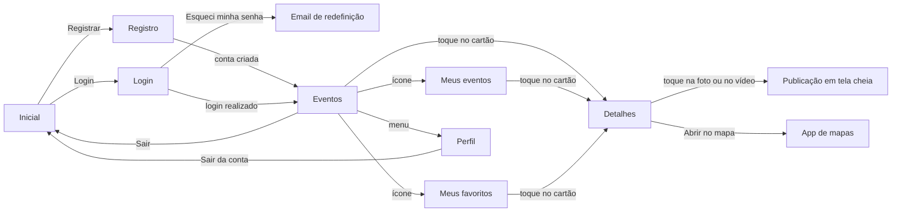
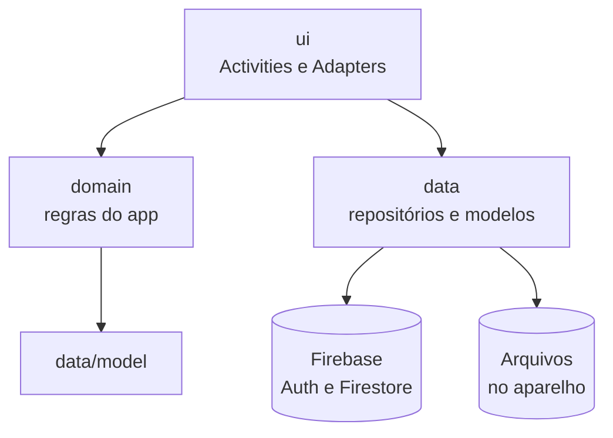

# CampusHub

Plataforma onde alunos podem visualizar os eventos da universidade, se inscrever neles, guardar os favoritos e compartilhar suas experiências.

App Android feito com Kotlin, Firebase Authentication e Cloud Firestore. Usa recursos nativos do aparelho: mapa, câmera, galeria e microfone.

## Funcionalidades

**Conta e perfil**

- **Conta:** registro com nome, curso, email e senha (com confirmação), login, logout e recuperação de senha por email
- **Login automático:** quem já entrou vai direto para os eventos ao abrir o app
- **Perfil:** mostra o email e permite editar o nome e o curso

**Eventos**

- **Lista:** cartões com tipo do evento, data, horário, local, vagas restantes, curso responsável e se o evento é aberto a todos ou exclusivo do curso
- **Busca e filtros:** busca pelo título (sem diferenciar acentos e maiúsculas), filtro por situação (próximos, encerrados ou todos) e por categoria. Os três funcionam juntos
- **Detalhes:** data por extenso, descrição completa, média das avaliações e as ações do evento
- **Inscrição e cancelamento:** controle de vagas, bloqueio quando o evento lota, quando já aconteceu e, nos eventos exclusivos, para alunos de outros cursos
- **Meus eventos:** só os eventos em que o aluno está inscrito

**Interação**

- **Favoritos:** coração nos detalhes para favoritar ou desfavoritar, e a tela **Meus favoritos**. Favoritar não é se inscrever: não reserva vaga
- **Comentários:** qualquer aluno logado comenta. Cada comentário mostra o nome do autor e a data, e só o autor pode editar ou excluir o próprio comentário
- **Avaliações:** quem estava inscrito avalia o evento depois que ele termina, com nota de 1 a 5. É uma avaliação por aluno, e a nota pode ser alterada. Os detalhes mostram a média e a quantidade de avaliações

**Localização e publicações**

- **Mapa:** cada evento tem endereço e um ponto no mapa (OpenStreetMap). Nos eventos do campus, o ponto fica no prédio do curso, e os eventos em auditório ficam no Prédio 4, onde estão os auditórios. **Abrir no mapa** abre o app de mapas do celular
- **Fotos:** o aluno tira uma foto com a câmera ou escolhe uma da galeria e publica no evento. Tocar na foto abre em tela cheia
- **Áudios:** o aluno grava um áudio de até 1 minuto e publica. Qualquer aluno toca e pausa o áudio na própria lista
- **Vídeos:** o aluno grava um vídeo de até 30 segundos ou escolhe um da galeria (vídeos mais longos são recusados). A lista mostra a miniatura e a duração, e o vídeo toca em tela cheia
- **Autor e data:** toda publicação mostra quem publicou e quando, e só o autor pode excluir
- As publicações não dependem de inscrição, comentários ou avaliações: qualquer aluno logado publica

**Geral**

- **Modo escuro:** todas as telas acompanham o tema do sistema

## Telas

- **Inicial:** nome do app e botões de Login e Registrar
- **Registro:** nome, curso (escolhido numa lista), email, senha e confirmação de senha
- **Login:** email e senha, com o link **Esqueci minha senha**
- **Eventos:** saudação com o nome do aluno, campo de busca, filtros de situação e categoria e os cartões dos eventos
- **Detalhes do evento:** informações completas, média das avaliações, inscrição ou cancelamento, coração de favorito, sua avaliação (em eventos encerrados), descrição, localização com o mapa, publicações e comentários
- **Publicação em tela cheia:** a foto, ou o vídeo com os controles, e o autor e a data na barra
- **Meus eventos** e **Meus favoritos:** os eventos inscritos ou favoritados, ou um aviso quando a lista está vazia
- **Perfil:** avatar com as iniciais, email e edição do nome e do curso

## Fluxo



1. O app abre na tela **Inicial**. Se já existe uma sessão salva, vai direto para os **Eventos**.
2. No **Registro**, o Firebase cria a conta e o app salva nome, curso e email no Firestore.
3. No **Login**, o link **Esqueci minha senha** manda um email de redefinição pelo Firebase.
4. Na lista de **Eventos**, a busca e os filtros mudam os cartões na hora, sem consultar o Firestore de novo. A lista abre mostrando os próximos eventos.
5. Nos **Detalhes**, o aluno se inscreve ou cancela, favorita, comenta e, se o evento já terminou e ele estava inscrito, avalia. Quando uma ação não é permitida, o botão fica desativado mostrando o motivo.
6. Ainda nos **Detalhes**, o mapa mostra onde é o evento, e o botão **Publicar** oferece tirar foto, escolher foto, gravar áudio, gravar vídeo ou escolher vídeo. A câmera e a galeria são as do próprio Android, e o microfone é pedido só na primeira gravação.
7. **Meus eventos** e **Meus favoritos** abrem pelos ícones da barra. **Perfil** e **Sair** ficam no menu ⋮.

## Banco de dados (Firestore)

```
users/{uid}                          perfil do aluno
    name, course, email
    enrollments/{eventId}            uma inscrição por evento
        eventId, enrolledAt
    favorites/{eventId}              um favorito por evento
        eventId, favoritedAt

events/{eventId}
    title, description, location, date
    category, course, openToAll
    capacity, enrolledCount
    address, coordinates             endereço e ponto no mapa (GeoPoint)
    comments/{commentId}             comentários do evento
        userId, authorName, text, createdAt, editedAt
    ratings/{uid}                    uma avaliação por aluno
        userId, value, updatedAt
    media/{mediaId}                  publicações de foto, áudio e vídeo
        userId, authorName, type, fileName, durationMs, createdAt
```

- O `uid` vem do Firebase Authentication, o que liga o perfil à conta.
- **Ids que evitam repetição:** inscrições e favoritos usam o id do evento, e avaliações usam o uid do aluno. Assim o aluno não se inscreve duas vezes, não favorita duas vezes e tem uma única avaliação por evento. Mudar a nota só substitui o documento.
- **Inscrever e cancelar são transações:** a inscrição e o contador `enrolledCount` mudam juntos. Se dois alunos tentarem a última vaga ao mesmo tempo, o Firestore repete uma das tentativas, que encontra o evento lotado.
- **Média das avaliações:** calculada pelo próprio Firestore com uma consulta de agregação (`average` e `count`), sem baixar as notas uma a uma.
- **Comentários:** guardam o nome do autor no próprio documento, para não buscar o perfil de cada um. As datas (`createdAt`, `editedAt`) vêm do servidor, não do relógio do celular.
- **Publicações:** o Firestore guarda só os dados (autor, tipo, nome do arquivo, duração e data). O arquivo fica na pasta privada do app, no aparelho de quem publicou, como o enunciado permite. Em outro aparelho, a publicação aparece com o aviso de que o arquivo está só no aparelho do autor. Ao excluir, o app apaga o documento e o arquivo.
- **Eventos de exemplo:** na primeira execução, se a coleção `events` estiver vazia, o app grava 12 eventos (`SampleEvents.kt`). São 8 próximos e 4 já encerrados, de vários cursos e categorias. Sempre que a lista carrega, os eventos já gravados recebem a sala, o endereço e o ponto no mapa do exemplo de mesmo título. Assim, mudar um local no código atualiza o Firestore.
- **Pontos no mapa:** o OpenStreetMap não tem os prédios do campus desenhados. As coordenadas dos prédios e do Fórum de Santiago foram tiradas do Google Maps, usando a rotatória da entrada do campus como referência.

### Dados no console do Firebase

Contas criadas pela tela de Registro, em **Authentication > Usuários**:


Perfil salvo no Firestore pelo Registro, na coleção `users`. O id do documento é o mesmo UID do Authentication:


Um dos eventos de exemplo na coleção `events`, com o curso e o tipo de acesso:


## Arquitetura

O código é dividido em três camadas. Cada uma só conhece a de baixo:



- **`ui`** mostra os dados e reage aos toques. As telas não chamam o Firebase direto: pedem aos repositórios e perguntam às regras o que pode ser feito.
- **`data`** é o único lugar que fala com o Firebase e com os arquivos das publicações. Cada repositório cuida de uma parte dos dados e devolve uma `Task`, que a tela trata com `addOnSuccessListener` e `addOnFailureListener`.
- **`domain`** guarda as regras do app em Kotlin puro, sem Android nem Firebase: validação do cadastro, busca e filtros, quando o aluno pode se inscrever, cancelar e avaliar, quem exclui uma publicação e os limites de duração dos áudios e vídeos. Por isso essas regras podem ser testadas sem emulador.

```
app/src/main/
├── java/br/com/uri/campushub/
│   ├── ui/
│   │   ├── auth/
│   │   │   ├── MainActivity.kt           tela inicial e login automático
│   │   │   ├── RegisterActivity.kt       cria a conta e o perfil
│   │   │   └── LoginActivity.kt          login e recuperação de senha
│   │   ├── events/
│   │   │   ├── EventsActivity.kt         lista de eventos, busca e filtros
│   │   │   ├── MyEventsActivity.kt       Meus eventos e Meus favoritos (a mesma tela, com listas diferentes)
│   │   │   ├── EventAdapter.kt           cartões dos eventos
│   │   │   └── EventChips.kt             etiquetas de curso e de acesso
│   │   ├── details/
│   │   │   ├── EventDetailsActivity.kt   detalhes, inscrição, favorito, comentários e avaliação
│   │   │   ├── CommentAdapter.kt         lista de comentários e menu de editar/excluir
│   │   │   └── EventMap.kt               mapa do evento (osmdroid) e Abrir no mapa
│   │   ├── media/
│   │   │   ├── MediaSection.kt           cartão Publicações: publicar, listar e excluir
│   │   │   ├── MediaAdapter.kt           foto, áudio ou vídeo de cada publicação
│   │   │   ├── MediaViewerActivity.kt    foto ou vídeo em tela cheia
│   │   │   ├── AudioPlayer.kt            toca um áudio por vez na lista
│   │   │   ├── RecordAudioDialog.kt      janela de gravação com o tempo e o limite
│   │   │   └── CaptureShortVideo.kt      pede à câmera o limite de 30 segundos
│   │   ├── profile/
│   │   │   └── ProfileActivity.kt        dados do aluno
│   │   └── common/
│   │       ├── ScreenSetup.kt            barra superior e espaço das barras do sistema e do teclado
│   │       └── Avatar.kt                 iniciais do perfil e dos comentários
│   ├── data/
│   │   ├── model/
│   │   │   ├── Event.kt                  evento, formatos de data, vagas, encerrado e curso
│   │   │   ├── Comment.kt                comentário
│   │   │   ├── User.kt                   perfil do aluno
│   │   │   ├── MediaPost.kt              publicação de foto, áudio ou vídeo
│   │   │   └── RatingSummary.kt          média e quantidade de avaliações
│   │   ├── repository/
│   │   │   ├── AuthRepository.kt         login, cadastro, recuperação de senha e logout
│   │   │   ├── UserRepository.kt         perfil em users/{uid}
│   │   │   ├── EventRepository.kt        lista, um evento ou vários pelos ids
│   │   │   ├── EnrollmentRepository.kt   inscrição e cancelamento (transações)
│   │   │   ├── FavoriteRepository.kt     favoritar e desfavoritar
│   │   │   ├── CommentRepository.kt      listar, criar, editar e excluir comentários
│   │   │   ├── RatingRepository.kt       nota do aluno e média do evento
│   │   │   └── MediaRepository.kt        listar, criar e excluir publicações
│   │   ├── media/
│   │   │   ├── MediaStorage.kt           arquivos das publicações na pasta do app
│   │   │   └── AudioRecorder.kt          gravação do microfone
│   │   └── SampleEvents.kt               eventos de exemplo e pontos dos prédios
│   └── domain/
│       ├── RegisterValidator.kt          validação do cadastro
│       ├── EventFilter.kt                ordem da lista, busca e filtros
│       ├── EnrollmentRules.kt            quando se inscrever e cancelar
│       ├── RatingRules.kt                quando avaliar e limites da nota
│       └── MediaRules.kt                 quem exclui e limites de áudio e vídeo
├── res/
│   ├── layout/                           telas, cartões, itens das listas e diálogos
│   ├── drawable/                         ícones e fundos
│   ├── color/                            cores das opções de filtro (marcada ou não)
│   ├── menu/                             menus da barra, dos comentários e das publicações
│   ├── xml/                              regras de backup e a pasta que o FileProvider abre para a câmera
│   ├── values/                           textos, cores, temas, estilos, cursos e categorias
│   └── values-night/                     cores e temas do modo escuro
└── AndroidManifest.xml
```

- **Repositórios** recebem o `FirebaseAuth` e o `FirebaseFirestore` pelo construtor, com a instância padrão como valor inicial. As telas usam o padrão, e os testes podem passar o Firebase Emulator.
- **Regras** devolvem um `enum` com o resultado (por exemplo `EnrollmentRules.Status.SOLD_OUT`). A tela escolhe a mensagem e o estado do botão a partir dele, então a regra não depende de textos nem de layout.
- **Navegação** com `Intent`. As telas de detalhes recebem só o id do evento e buscam os dados atualizados.
- **Barras do sistema e teclado:** a partir do Android 15 o app desenha atrás das barras. As telas com barra própria usam o `ScreenSetup.kt`, que reserva o espaço da barra de status, da barra de navegação e do teclado. Assim o campo de comentário continua visível enquanto o aluno digita.
- **Adapters** só mostram os dados e avisam a tela quando algo é tocado.
- **Textos** da interface ficam em `strings.xml`, e os cursos e as categorias em `string-array`.
- **Mapa isolado:** todo o código do osmdroid fica em `EventMap.kt`. Trocar o OpenStreetMap por outro mapa no futuro mexe só nesse arquivo e no layout.
- **Câmera e galeria sem permissão:** a foto e o vídeo são feitos pelo app de câmera do celular, que grava direto no arquivo do app por um endereço do `FileProvider`. A galeria usa o seletor de fotos do Android, que também não pede permissão. A única permissão pedida ao aluno é a do microfone, na hora de gravar.
- **Limites de duração:** o gravador de áudio para sozinho em 1 minuto. A câmera recebe o limite de 30 segundos, mas nem todo app de câmera respeita. Por isso o app confere a duração do vídeo antes de publicar, como faz com os vídeos da galeria.
- **Ciclo de vida:** ao sair da tela, o áudio pausa e uma gravação em andamento é descartada, porque o Android não deixa usar o microfone em segundo plano. O vídeo em tela cheia continua de onde parou ao voltar.

## Tecnologias

- Kotlin com layouts XML
- Firebase Authentication (email e senha) e Cloud Firestore (transações e agregações)
- Material Components (cartões, chips, campos, botões e barras)
- RecyclerView
- osmdroid (mapa do OpenStreetMap)
- Glide (fotos e miniaturas dos vídeos)
- Activity Result API (câmera, galeria e permissão), MediaRecorder, MediaPlayer e VideoView
- minSdk 36

## Como rodar

1. Clone o repositório e abra no Android Studio.
2. Crie um projeto no [console do Firebase](https://console.firebase.google.com/) e adicione um app Android com o pacote `br.com.uri.campushub`.
3. Baixe o arquivo `google-services.json` e coloque na pasta `app/`. Ele não está no repositório.
4. No console do Firebase:
   - em **Authentication > Método de login**, ative **E-mail/senha**;
   - em **Firestore Database**, crie o banco em **modo de teste**.
5. Sincronize o Gradle e rode o app. Os eventos de exemplo são criados no primeiro acesso à lista.

### Testar no emulador

- **Câmera:** no AVD, configure as câmeras em **Device Manager > Edit > Advanced Settings**, com a traseira como **VirtualScene** e a frontal como **Emulated**. Sem câmera, o app avisa que não encontrou um app de câmera.
- **Microfone:** o emulador grava pelo microfone do computador. Em **Extended Controls > Microphone**, ative **Virtual microphone uses host audio input**.
- **Vídeos na galeria:** envie um vídeo para o emulador e avise a galeria:

  ```bash
  adb push video.mp4 /sdcard/Movies/
  adb shell am broadcast -a android.intent.action.MEDIA_SCANNER_SCAN_FILE -d file:///sdcard/Movies/video.mp4
  ```

### Testar as avaliações

O app não deixa se inscrever em eventos que já terminaram, e só quem estava inscrito pode avaliar. Para testar com um dos eventos encerrados de exemplo, crie a inscrição pelo console:

1. Em `events`, copie o id de um evento encerrado (por exemplo, "Dia de Campo: Manejo do Solo").
2. Em `users/{seu uid}`, crie a subcoleção `enrollments` com um documento cujo id é o id do evento e com o campo `eventId` igual a esse id.
3. Abra o evento no app: o cartão **Sua avaliação** aparece.
