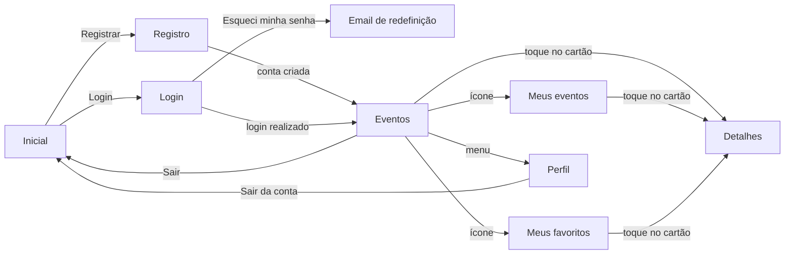
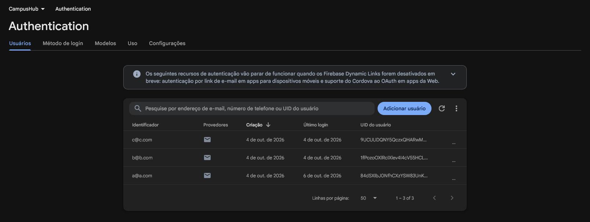
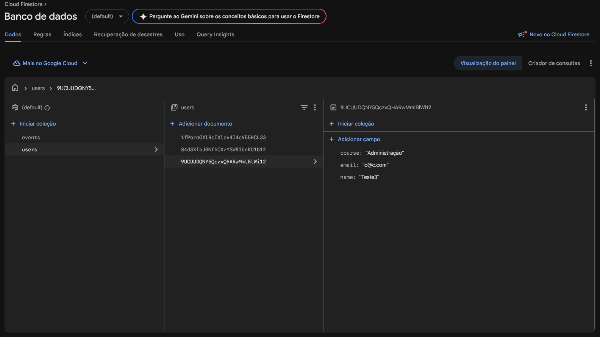
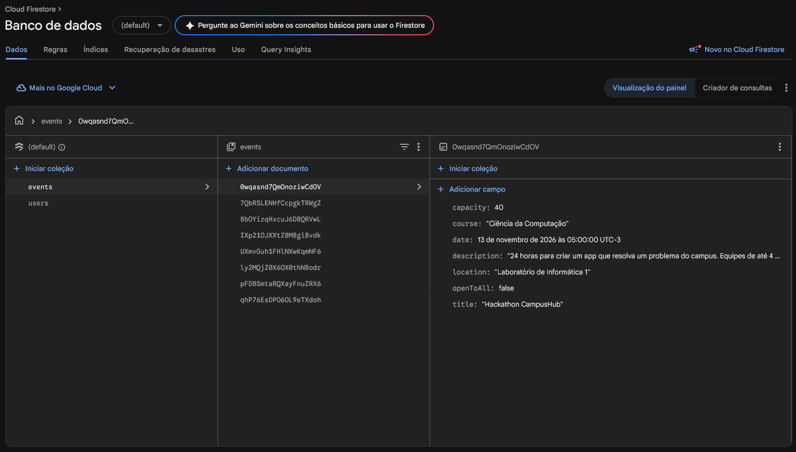

# CampusHub

Plataforma onde alunos podem visualizar os eventos da universidade, se inscrever neles, guardar os favoritos e compartilhar suas experiências.

App Android feito com Kotlin, Firebase Authentication e Cloud Firestore.

## Funcionalidades

**Conta e perfil**

- **Conta:** registro com nome, curso, email e senha (com confirmação), login, logout e recuperação de senha por email
- **Login automático:** quem já entrou vai direto para os eventos ao abrir o app
- **Perfil:** mostra o email e permite editar o nome e o curso

**Eventos**

- **Lista:** cartões com tipo do evento, data, horário, local, vagas restantes, curso responsável e se o evento é aberto a todos ou exclusivo do curso
- **Busca e filtros:** busca pelo título (sem diferenciar acentos e maiúsculas), filtro por situação (próximos, encerrados ou todos) e por categoria. Os três funcionam juntos
- **Detalhes:** data por extenso, descrição completa, média das avaliações e as ações do evento
- **Inscrição e cancelamento:** controle de vagas, bloqueio quando o evento lota, quando já aconteceu e, nos eventos exclusivos, para alunos de outros cursos
- **Meus eventos:** só os eventos em que o aluno está inscrito

**Interação**

- **Favoritos:** coração nos detalhes para favoritar ou desfavoritar, e a tela **Meus favoritos**. Favoritar não é se inscrever: não reserva vaga
- **Comentários:** qualquer aluno logado comenta. Cada comentário mostra o nome do autor e a data, e só o autor pode editar ou excluir o próprio comentário
- **Avaliações:** quem estava inscrito avalia o evento depois que ele termina, com nota de 1 a 5. É uma avaliação por aluno, e a nota pode ser alterada. Os detalhes mostram a média e a quantidade de avaliações

**Geral**

- **Modo escuro:** todas as telas acompanham o tema do sistema

## Telas

- **Inicial:** nome do app e botões de Login e Registrar
- **Registro:** nome, curso (escolhido numa lista), email, senha e confirmação de senha
- **Login:** email e senha, com o link **Esqueci minha senha**
- **Eventos:** saudação com o nome do aluno, campo de busca, filtros de situação e categoria e os cartões dos eventos
- **Detalhes do evento:** informações completas, média das avaliações, inscrição ou cancelamento, coração de favorito, sua avaliação (em eventos encerrados), descrição e comentários
- **Meus eventos** e **Meus favoritos:** os eventos inscritos ou favoritados, ou um aviso quando a lista está vazia
- **Perfil:** avatar com as iniciais, email e edição do nome e do curso

## Fluxo



1. O app abre na tela **Inicial**. Se já existe uma sessão salva, vai direto para os **Eventos**.
2. No **Registro**, o Firebase cria a conta e o app salva nome, curso e email no Firestore.
3. No **Login**, o link **Esqueci minha senha** manda um email de redefinição pelo Firebase.
4. Na lista de **Eventos**, a busca e os filtros mudam os cartões na hora, sem consultar o Firestore de novo. A lista abre mostrando os próximos eventos.
5. Nos **Detalhes**, o aluno se inscreve ou cancela, favorita, comenta e, se o evento já terminou e ele estava inscrito, avalia. Quando uma ação não é permitida, o botão fica desativado mostrando o motivo.
6. **Meus eventos** e **Meus favoritos** abrem pelos ícones da barra. **Perfil** e **Sair** ficam no menu ⋮.

## Banco de dados (Firestore)

```
users/{uid}                          perfil do aluno
    name, course, email
    enrollments/{eventId}            uma inscrição por evento
        eventId, enrolledAt
    favorites/{eventId}              um favorito por evento
        eventId, favoritedAt

events/{eventId}
    title, description, location, date
    category, course, openToAll
    capacity, enrolledCount
    comments/{commentId}             comentários do evento
        userId, authorName, text, createdAt, editedAt
    ratings/{uid}                    uma avaliação por aluno
        userId, value, updatedAt
```

- O `uid` vem do Firebase Authentication, o que liga o perfil à conta.
- **Ids que evitam repetição:** inscrições e favoritos usam o id do evento, e avaliações usam o uid do aluno. Assim o aluno não se inscreve duas vezes, não favorita duas vezes e tem uma única avaliação por evento. Mudar a nota só substitui o documento.
- **Inscrever e cancelar são transações:** a inscrição e o contador `enrolledCount` mudam juntos. Se dois alunos tentarem a última vaga ao mesmo tempo, o Firestore repete uma das tentativas, que encontra o evento lotado.
- **Média das avaliações:** calculada pelo próprio Firestore com uma consulta de agregação (`average` e `count`), sem baixar as notas uma a uma.
- **Comentários:** guardam o nome do autor no próprio documento, para não buscar o perfil de cada um. As datas (`createdAt`, `editedAt`) vêm do servidor, não do relógio do celular.
- **Eventos de exemplo:** na primeira execução, se a coleção `events` estiver vazia, o app grava 12 eventos (`SampleEvents.kt`). São 8 próximos e 4 já encerrados, de vários cursos e categorias.

### Dados no console do Firebase

Contas criadas pela tela de Registro, em **Authentication > Usuários**:



Perfil salvo no Firestore pelo Registro, na coleção `users`. O id do documento é o mesmo UID do Authentication:



Um dos eventos de exemplo na coleção `events`, com o curso e o tipo de acesso:



## Arquitetura

Cada tela é uma `Activity` com o seu layout XML, e as próprias Activities chamam o Firebase.

```
app/src/main/
├── java/br/com/uri/campushub/
│   ├── MainActivity.kt           tela inicial e login automático
│   ├── RegisterActivity.kt       cria a conta e o perfil
│   ├── LoginActivity.kt          login e recuperação de senha
│   ├── EventsActivity.kt         lista de eventos, busca e filtros
│   ├── EventDetailsActivity.kt   detalhes, inscrição, favorito, comentários e avaliação
│   ├── MyEventsActivity.kt       Meus eventos e Meus favoritos (a mesma tela, com listas diferentes)
│   ├── ProfileActivity.kt        dados do aluno
│   ├── Event.kt                  modelo do evento, datas e regras (vagas, encerrado, curso)
│   ├── Comment.kt                modelo do comentário
│   ├── EventAdapter.kt           cartões dos eventos
│   ├── CommentAdapter.kt         lista de comentários e menu de editar/excluir
│   ├── EventChips.kt             etiquetas de curso e de acesso
│   ├── Avatar.kt                 iniciais do perfil e dos comentários
│   └── SampleEvents.kt           eventos de exemplo
├── res/
│   ├── layout/                   telas, cartões, itens das listas e diálogos
│   ├── drawable/                 ícones e fundos
│   ├── color/                    cores das opções de filtro (marcada ou não)
│   ├── menu/                     menus da barra e dos comentários
│   ├── values/                   textos, cores, temas, estilos, cursos e categorias
│   └── values-night/             cores e temas do modo escuro
└── AndroidManifest.xml
```

- **Navegação** com `Intent`. As telas de detalhes recebem só o id do evento e buscam os dados atualizados.
- **Telas com conteúdo no topo** usam uma `MaterialToolbar` própria e ajustam o espaço das barras do sistema, já que a partir do Android 15 o app desenha atrás delas.
- **Adapters** só mostram os dados e avisam a tela quando algo é tocado. Quem grava no Firestore são as Activities.
- **Textos** da interface ficam em `strings.xml`, e os cursos e as categorias em `string-array`.

## Tecnologias

- Kotlin com layouts XML
- Firebase Authentication (email e senha) e Cloud Firestore (transações e agregações)
- Material Components (cartões, chips, campos, botões e barras)
- RecyclerView
- minSdk 36

## Como rodar

1. Clone o repositório e abra no Android Studio.
2. Crie um projeto no [console do Firebase](https://console.firebase.google.com/) e adicione um app Android com o pacote `br.com.uri.campushub`.
3. Baixe o arquivo `google-services.json` e coloque na pasta `app/`. Ele não está no repositório.
4. No console do Firebase:
   - em **Authentication > Método de login**, ative **E-mail/senha**;
   - em **Firestore Database**, crie o banco em **modo de teste**.
5. Sincronize o Gradle e rode o app. Os eventos de exemplo são criados no primeiro acesso à lista.

### Testar as avaliações

O app não deixa se inscrever em eventos que já terminaram, e só quem estava inscrito pode avaliar. Para testar com um dos eventos encerrados de exemplo, crie a inscrição pelo console:

1. Em `events`, copie o id de um evento encerrado (por exemplo, "Dia de Campo: Manejo do Solo").
2. Em `users/{seu uid}`, crie a subcoleção `enrollments` com um documento cujo id é o id do evento e com o campo `eventId` igual a esse id.
3. Abra o evento no app: o cartão **Sua avaliação** aparece.
